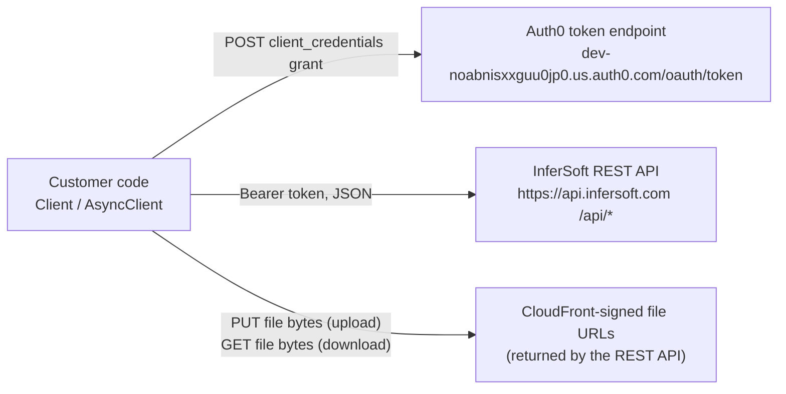
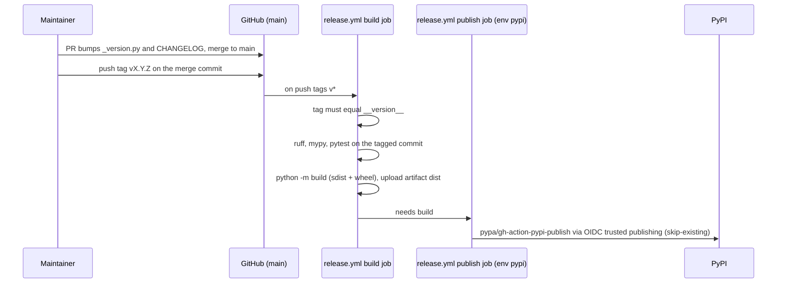

# Maintaining infer-python

`infer-python` is the Python client for the InferSoft public REST API, published to PyPI as [`infersoft`](https://pypi.org/project/infersoft/). It is hand-written: there is no code generator, and every model, resource method and selector builder was written against the API's OpenAPI spec ([api.infersoft.com/openapi.yaml](https://api.infersoft.com/openapi.yaml)). The .NET SDK, [infer-dotnet](https://github.com/InferSoft-inc/infer-dotnet), exposes the same surface, so an API change normally lands in both SDKs.

The customer-facing docs are [README.md](../README.md) (behavior and examples), [api.md](../api.md) (every public method and the REST calls it makes) and [CHANGELOG.md](../CHANGELOG.md). Keep all three accurate in the same PR as a code change; `pyproject.toml` ships README.md as the PyPI project description, which is why its links are absolute GitHub URLs.

## What the SDK talks to



| Dependency | How the SDK reaches it | Code |
|---|---|---|
| Auth0 token endpoint | `POST` with `grant_type=client_credentials`, `client_id`, `client_secret`, `audience` (and `scope` if set). Token cached until 60 s before `expires_in`, refreshed single-flight, refreshed once more on a 401. 30 s timeout of its own. | [`_auth.py`](../src/infersoft/_auth.py) |
| REST API | One pooled `httpx` client with `base_url`, the auth flow above, `User-Agent: infersoft-python/<version>`. | [`_http.py`](../src/infersoft/_http.py) |
| CloudFront-signed file URLs | A second pooled `httpx` client without auth (a bearer token would break the signature) and with `upload_timeout`. Used for upload `PUT`s and download `GET`s. | [`_http.py`](../src/infersoft/_http.py) `put_presigned` / `get_presigned` |

The defaults (`https://api.infersoft.com` for base URL and audience, the `dev-noabnisxxguu0jp0` Auth0 tenant for the token URL) are the production values. The API accepts only tokens whose audience is its own base URL, so `base_url`, `token_url` and `audience` are overridden together (constructor arguments or the `INFERSOFT_BASE_URL`, `INFERSOFT_TOKEN_URL` and `INFERSOFT_AUDIENCE` environment variables), with credentials issued for that environment.

The interactive API docs are at [api.infersoft.com/documentation](https://api.infersoft.com/documentation/) and the spec at [api.infersoft.com/openapi.yaml](https://api.infersoft.com/openapi.yaml).

## Local development

Work in a virtualenv (`.venv/` is gitignored). The last four commands are the ones CI runs:

```bash
python -m venv .venv
. .venv/bin/activate
pip install -e ".[dev]"
ruff check .
mypy src
pytest -q
```

`mypy` runs in strict mode (`[tool.mypy]` in `pyproject.toml`); `ruff` selects `E,F,I,B,UP` with a 100-character line length.

## CI

[`.github/workflows/ci.yml`](../.github/workflows/ci.yml) runs on every pull request and on pushes to `main`: install, `ruff check .`, `mypy src`, `pytest -q`, on Python 3.10, 3.11, 3.12, 3.13 and 3.14. It needs no secrets. Actions are pinned to commit SHAs.

`main` is the default branch and the only release branch. [CODEOWNERS](../.github/CODEOWNERS) assigns every path to the `InferSoft-inc/infersoft-it` team.

## Releasing to PyPI

Versions follow Semantic Versioning. The version lives only in [`src/infersoft/_version.py`](../src/infersoft/_version.py) (hatchling reads it through `[tool.hatch.version]`); it is also sent in the `User-Agent` header.



1. In a PR to `main`, set `__version__` in `_version.py` and move the `## [Unreleased]` notes in CHANGELOG.md under `## [X.Y.Z] - <date>`. Merge it.
2. Tag the merge commit by its SHA (a bare `git tag` would tag whatever is checked out locally) and push the tag:
   ```bash
   git fetch origin
   git tag vX.Y.Z <merge commit SHA>
   git push origin vX.Y.Z
   ```
3. [`.github/workflows/release.yml`](../.github/workflows/release.yml) builds and publishes:
   - **build & verify**: fails unless the tag without its `v` equals `__version__`, reruns `ruff`, `mypy` and `pytest`, builds the sdist and wheel, uploads them as the `dist` artifact.
   - **publish to PyPI**: runs in the GitHub environment `pypi`, which only accepts refs matching the tag pattern `v*`. It has `id-token: write` and publishes through PyPI Trusted Publishing (GitHub OpenID Connect, OIDC), so there is no PyPI token or repository secret. The PyPI trusted publisher must stay registered for this repo, `release.yml` and the `pypi` environment. `skip-existing: true` lets a failed publish be re-run without burning the version.

A tag pushed on a commit whose `_version.py` does not match fails the version check and publishes nothing.

Published versions and their dates are on [PyPI](https://pypi.org/project/infersoft/#history) and in [CHANGELOG.md](../CHANGELOG.md).

## Code layout

| Path | What it holds |
|---|---|
| [`src/infersoft/__init__.py`](../src/infersoft/__init__.py) | Public exports (`__all__`): clients, errors, models, selector builders. |
| [`src/infersoft/_client.py`](../src/infersoft/_client.py) | `Client` and `AsyncClient`: settings resolution from arguments and `INFERSOFT_*` environment variables, `with_options`, the `extract` pipeline. |
| [`src/infersoft/_auth.py`](../src/infersoft/_auth.py) | OAuth2 client-credentials `httpx.Auth` (sync and async flows). |
| [`src/infersoft/_http.py`](../src/infersoft/_http.py) | Request sending, retry policy, `Idempotency-Key` header, request-in-progress 409 handling, presigned transfers. |
| [`src/infersoft/_wait.py`](../src/infersoft/_wait.py) | Polling helper and the default wait budgets (30 minutes for jobs, 10 minutes for documents, 2 s interval). |
| [`src/infersoft/errors.py`](../src/infersoft/errors.py) | Exception hierarchy and the status code to exception mapping. |
| [`src/infersoft/models.py`](../src/infersoft/models.py) | Pydantic v2 response models (`extra="allow"`, so unknown server fields survive in `model_extra`) and extensible string enums. |
| [`src/infersoft/selectors.py`](../src/infersoft/selectors.py) | `build_*_selector` helpers, one per selector type in the spec. |
| [`src/infersoft/resources/`](../src/infersoft/resources/) | One module per resource (`documents`, `folders`, `projects`, `prompts`, `jobs`), each with a sync and an async class. |
| [`src/infersoft/_version.py`](../src/infersoft/_version.py) | `__version__`, the single version source. |
| [`tests/`](../tests/) | pytest suite; HTTP is mocked with `pytest-httpx`, so no credentials or network are needed. [`tests/test_examples.py`](../tests/test_examples.py) compiles every script in `examples/`. |
| [`examples/`](../examples/) | Runnable scripts; they need real credentials in `INFERSOFT_CLIENT_ID` / `INFERSOFT_CLIENT_SECRET`. |

Sync and async classes are written side by side and must stay identical in signatures and behavior (api.md promises one-to-one parity).

## How the SDK maps to the REST API

The API records and replays responses per `Idempotency-Key` on its write routes (in the spec, the operations whose responses advertise `Idempotency-Replayed`) and ignores the header everywhere else: the read-style `POST` searches, `POST /api/folders/paths` and `DELETE`. The SDK follows the same split: it sends a key (auto-generated UUID4 hex, or the caller's `idempotency_key`) only to the recorded routes, and marks read-style `POST`s `idempotent=True` so they are retried without a key.

| Route | SDK methods | SDK sends `Idempotency-Key` |
|---|---|---|
| `POST /api/uploads` | `documents.upload`, `upload_many` (key `<base>-NNNN` per batch) | yes |
| `POST /api/documents/search` | `documents.search`, `iterate`, `get_values`, `wait_until_ready`, `jobs.results` | no |
| `GET /api/documents/{id}` | `documents.get`, `download` (name lookup) | no |
| `GET /api/documents/{id}/download` | `documents.download_url`, `download` | no |
| `DELETE /api/documents/{id}` | `documents.delete`, `upload(on_duplicate="block")` | no |
| `POST /api/documents/move-to-folder` | `documents.move_to_folder` | yes |
| `POST /api/documents/bulk_delete` | `documents.bulk_delete` | yes |
| `POST /api/folders` | `folders.create` | yes |
| `GET /api/folders/{id}` | `folders.get` | no |
| `PATCH /api/folders/{id}` | `folders.rename` | yes |
| `POST /api/folders/search` | `folders.search`, `iterate` | no |
| `POST /api/folders/move` | `folders.move` | yes |
| `POST /api/folders/paths` | `folders.resolve_paths`, `ensure_path` | no |
| `POST /api/folders/bulk_delete` | `folders.bulk_delete` | yes |
| `POST /api/projects` | `projects.create`, `get_or_create` | yes |
| `GET /api/projects/{id}` | `projects.get` | no |
| `POST /api/projects/search` | `projects.search`, `iterate`, `get_or_create` | no |
| `POST /api/projects/assign-documents` | `projects.assign_documents` | yes |
| `POST /api/prompts/search` | `prompts.search`, `iterate` | no |
| `POST /api/jobs/credits/estimate` | `jobs.estimate`, `run` | yes |
| `POST /api/jobs/credits/quote` | `jobs.quote` | no |
| `POST /api/jobs/start` | `jobs.start`, `run` | yes |
| `GET /api/jobs/{id}` | `jobs.get`, `wait`, `run(wait=True)` | no |
| `POST /api/jobs/search` | `jobs.search`, `iterate` | no |

Routes in the spec that the SDK deliberately does not wrap: `POST /api/documents/{id}/resplit` and `POST /api/documents/{id}/split` (marked deprecated and internal-only in the spec) and `POST /api/documents/extraction_results/search` (deprecated; extraction values come from `documents.search` with `prompts`).

### Server contracts copied by hand

These values live in the SDK and in the API. Change them together.

| SDK | REST API |
|---|---|
| `_PROBLEM_TYPE_REQUEST_IN_PROGRESS` in [`_http.py`](../src/infersoft/_http.py) | The problem `type` `https://api.infersoft.com/problems/request-in-progress` in the spec (the transient 409 the SDK retries, honoring `Retry-After`) |
| `MAX_BATCH_FILES = 100` in [`resources/documents.py`](../src/infersoft/resources/documents.py) | `BatchUploadRequest.files` `maxItems: 100` in the spec |
| `build_*_selector` set in [`selectors.py`](../src/infersoft/selectors.py) | `Selector` union in the spec |
| `JobStatus`, `DocumentStatus`, `DataTypeName` in [`models.py`](../src/infersoft/models.py) | `JobStatus`, `DocumentStatus`, `DataTypeName` enums in the spec |
| Terminal job statuses (`completed`, `failed`, `partial_success`) in [`resources/jobs.py`](../src/infersoft/resources/jobs.py) | `JobStatus` enum in the spec (`running` and `creating_workflows` are non-terminal) |
| Default endpoints in [`_client.py`](../src/infersoft/_client.py) | The production API's base URL and its Auth0 token endpoint |

Enums are extensible: an unknown value parses, is treated as non-terminal by the waiters, and each wait call logs one warning per unknown value. A new terminal status therefore needs an SDK release, or waits run until `max_wait_seconds`, and forever when it is `None` or 0.

### Keeping in sync with the spec

1. Find what changed in the API's spec ([api.infersoft.com/openapi.yaml](https://api.infersoft.com/openapi.yaml)) since the last SDK release; the date of the latest version in CHANGELOG.md is the starting point.
2. Update the models, resources and selector builders here and add tests that mock the new wire shape with `pytest-httpx`.
3. Update api.md and README.md, and add an entry under `## [Unreleased]` in CHANGELOG.md.
4. Make the same change in infer-dotnet.

## Dependencies

- Runtime: `httpx>=0.27,<1` and `pydantic>=2.7,<3`, declared as ranges with no lock file because this is a library.
- [Dependabot](../.github/dependabot.yml) opens one grouped weekly PR for GitHub Actions SHA pins. There is no `pip` ecosystem entry on purpose: raising the dependency floors would raise them for every consumer.

## Security reports

[SECURITY.md](../SECURITY.md): reports go through GitHub private vulnerability reporting; only the latest release is supported.

## Related repos

- [infer-dotnet](https://github.com/InferSoft-inc/infer-dotnet): the .NET SDK with the same surface.
